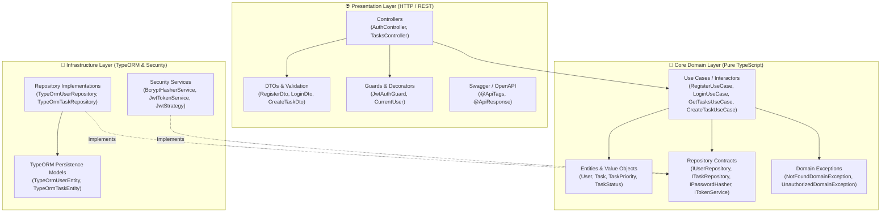

# TaskFlow REST API · NestJS Clean Architecture Showcase

[](https://nestjs.com)
[](https://www.typescriptlang.org/)
[](https://blog.cleancoder.com/uncle-bob/2012/08/13/the-clean-architecture.html)
[](https://swagger.io)
[-brightgreen)](src/)

A robust, enterprise-ready RESTful API built with **NestJS**, demonstrating **Clean / Hexagonal Architecture**, **JWT Authentication (Passport)**, **TypeORM with SQLite**, **Class Validator**, and **Unit Testing with Jest**.

---

## 🏛️ Architecture Overview

The application follows strict **Dependency Inversion**: inner layers (Domain) have zero knowledge of frameworks, ORMs, or HTTP protocols. External details (TypeORM, Express, Passport) depend inwards on Domain interfaces.



### Layer Responsibilities

| Layer | Responsibility | Dependencies |
| :--- | :--- | :--- |
| **Domain** | Contains pure business entities, validation rules, repository interfaces, and use cases. | None (Pure TypeScript) |
| **Infrastructure** | Implements domain contracts using external adapters: TypeORM persistence, bcrypt password hashing, and Passport JWT strategy. | `typeorm`, `sqlite3`, `bcrypt`, `passport-jwt` |
| **Presentation** | Handles HTTP requests, DTO validation pipelines, route guards, Swagger documentation, and maps domain exceptions to HTTP statuses. | `@nestjs/common`, `@nestjs/swagger`, `class-validator` |

---

## 📁 Project Structure

```
src/
├── app.module.ts                         # Root application module & TypeORM SQLite config
├── main.ts                               # Bootstrap: ValidationPipe, CORS, Swagger setup
├── core/
│   └── domain/
│       └── exceptions/                   # Custom domain exception hierarchy
└── modules/
    ├── auth/
    │   ├── auth.module.ts                # Module wiring & dependency injection
    │   ├── domain/
    │   │   ├── entities/                 # User entity
    │   │   ├── repositories/             # IUserRepository, IPasswordHasher, ITokenService
    │   │   └── usecases/                 # RegisterUseCase, LoginUseCase
    │   ├── infrastructure/
    │   │   ├── persistence/              # TypeOrmUserEntity, TypeOrmUserRepository
    │   │   ├── services/                 # BcryptHasherService, JwtTokenService
    │   │   └── strategies/               # JwtStrategy (Passport)
    │   └── presentation/
    │       ├── controllers/              # AuthController
    │       ├── dtos/                     # RegisterDto, LoginDto
    │       ├── guards/                   # JwtAuthGuard
    │       └── decorators/               # @CurrentUser()
    └── tasks/
        ├── tasks.module.ts
        ├── domain/
        │   ├── entities/                 # Task entity, TaskPriority, TaskStatus
        │   ├── repositories/             # ITaskRepository contract
        │   └── usecases/                 # GetTasks, CreateTask, UpdateTask, DeleteTask
        ├── infrastructure/
        │   └── persistence/              # TypeOrmTaskEntity, TypeOrmTaskRepository
        └── presentation/
            ├── controllers/              # TasksController
            └── dtos/                     # CreateTaskDto, UpdateTaskDto, TaskQueryDto
```

---

## ✨ Key Features

- **JWT Authentication Flow**: Secure user registration, password hashing with bcrypt, and signed JWT issuance.
- **Resource Ownership & User Isolation**: Tasks are strictly bound to their creator; cross-user mutations are rejected at the use case level.
- **Dynamic Filtering & Search**: Query tasks by status (`PENDING`, `IN_PROGRESS`, `COMPLETED`), priority (`LOW`, `MEDIUM`, `HIGH`), and text search.
- **Self-Contained SQLite Database**: Zero database configuration required—TypeORM automatically sets up SQLite on startup.
- **Interactive Swagger Documentation**: Full OpenAPI 3.0 documentation with JWT Authorization support at `/api/docs`.
- **Unit Testing**: 100% passing unit tests covering all Use Cases with mocked repositories.

---

## 📚 API Endpoints (Swagger Preview)

| Method | Endpoint | Description | Auth Required |
| :--- | :--- | :--- | :---: |
| `POST` | `/api/auth/register` | Register a new user account | No |
| `POST` | `/api/auth/login` | Authenticate and obtain JWT Bearer token | No |
| `GET` | `/api/auth/profile` | Get current authenticated user details | Yes (Bearer) |
| `GET` | `/api/tasks` | List all tasks for current user (supports filters) | Yes (Bearer) |
| `POST` | `/api/tasks` | Create a new task | Yes (Bearer) |
| `PATCH` | `/api/tasks/:id` | Update an existing task | Yes (Bearer) |
| `DELETE` | `/api/tasks/:id` | Delete a task | Yes (Bearer) |

---

## 🧪 Testing

```bash
# Run unit tests
npm test

# Run tests with coverage
npm run test:cov

# Build for production
npm run build
```

---

## 🚀 Getting Started

### Installation

```bash
# 1. Clone the repository
git clone https://github.com/v1dalhernan/nestjs-clean-architecture-api.git
cd nestjs-clean-architecture-api

# 2. Install dependencies
npm install

# 3. Configure environment
cp .env.example .env

# 4. Start the application in development mode
npm run start:dev
```

Once running:
- **API Base URL**: `http://localhost:3000/api`
- **Interactive Swagger Docs**: `http://localhost:3000/api/docs`

---

## 👤 Author

**Jhonathan Vidal**
- GitHub: [@v1dalhernan](https://github.com/v1dalhernan)
- LinkedIn: [Jhonathan Vidal](https://www.linkedin.com/in/jhonathan-vidal/)
